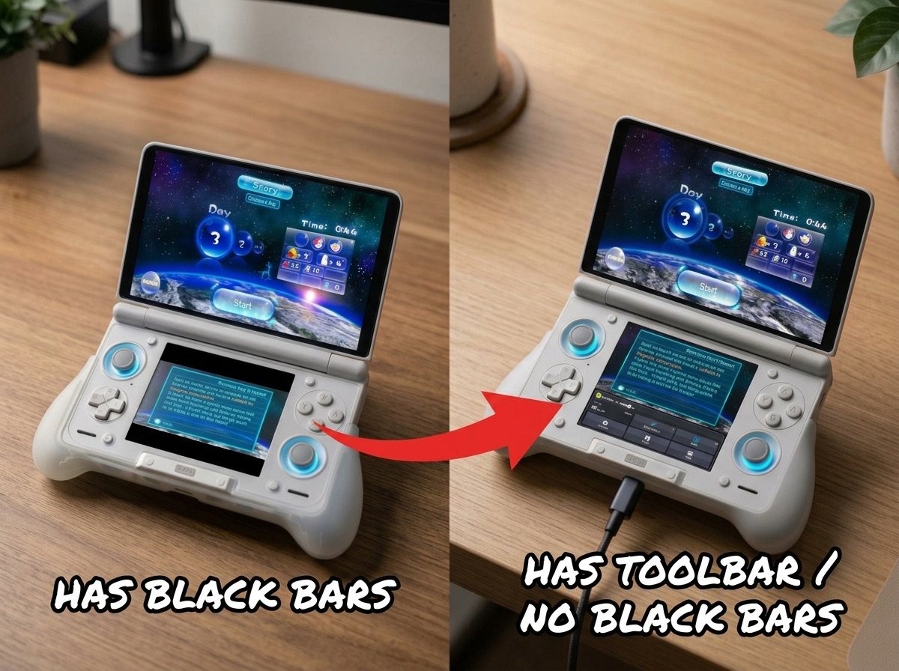
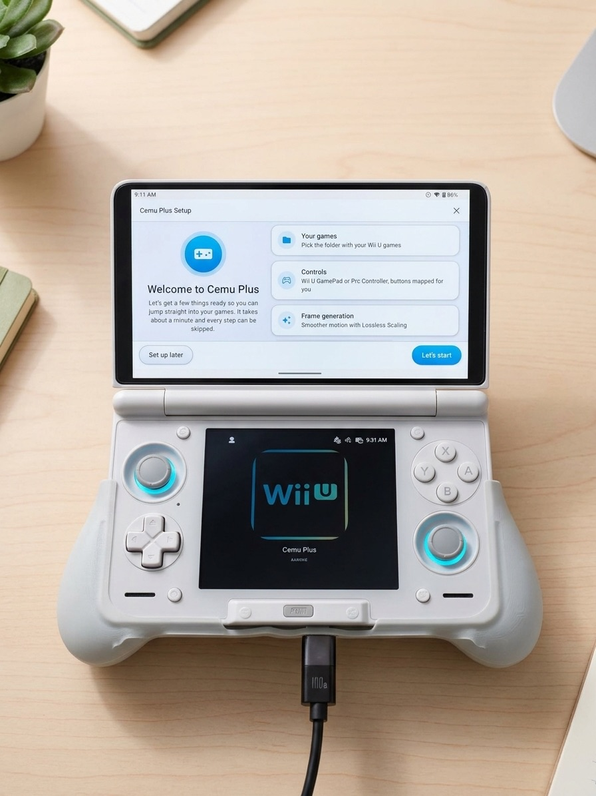
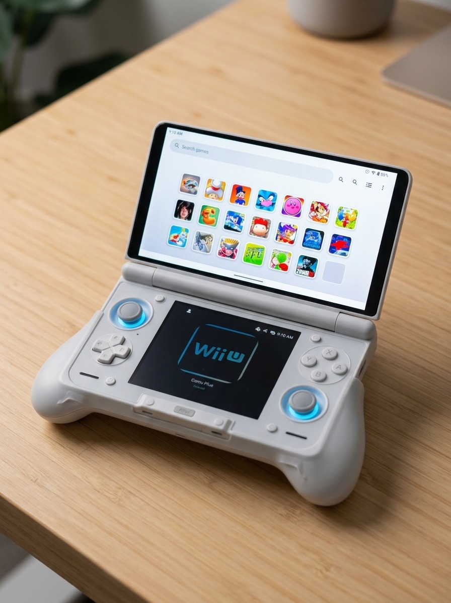

# Cemu Plus (Wii U Emulator for Android)

Cemu Plus is a fork of the [Cemu Android port](https://github.com/SapphireRhodonite/Cemu) built for handhelds,
especially dual screen devices like the AYN Thor. On top of everything the original port does, it adds the
features below. The Android port itself is still early and experimental, so stability and performance are not
guaranteed.

## What's new in this fork

### A toolbar instead of black bars

When the second screen has a different aspect ratio than the Wii U GamePad, the empty space is filled with a
Wii U style toolbar: FPS and performance stats, shader compilation progress and quick buttons for frame
generation, pause, the quick menu and settings.

### First time setup wizard

A Wii U style setup that walks you through picking your games folder, setting up controls (the GamePad goes to
the second screen automatically, and every button can be mapped in one tap), frame generation and the toolbar.
Every step can be skipped and opened again later from Settings.

### A nicer home screen

Bigger, better looking game icons in a clean grid, with search.

## Features

- **Lossless Scaling frame generation** (2x, 3x, 4x or a 60/90/120 FPS target) running in Cemu's Vulkan
  renderer, using your own `Lossless.dll`, inspired by [Eden Duo](https://github.com/igawa6/eden-duo)
- **Dual screen support**: GamePad on the second display, screen swap, rotation and top/center/bottom alignment
- **Per game GamePad screen crop**: cut the borders of the GamePad image so its middle fills more of a second
  screen that is not 16:9, with a preview of your screen in the game profile and a quick switch in the in-game menu
- **Controller hotkeys set up for you**: Setup all inputs also maps Select + Start to exit the game and
  Select + X to open the quick menu
- **GamePad toolbar** in the black bars with per stat toggles (FPS, CPU/GPU usage and clocks, temperatures,
  battery, RAM) and touch buttons for frame generation, pause, the quick menu and settings
- **First time setup wizard**, which can be reopened from Settings
- **In-game quick menu** to change frame generation and screen options while playing
- **AMD FSR 1 and Snapdragon GSR** upscale filters with a sharpness slider
- Installs next to the regular Cemu Android app (package `info.cemu.cemuplus`)

## Download

Grab the latest APK from the [releases page](https://github.com/danielcamilo1/cemu-plus/releases).

## Setting up frame generation

1. Copy `Lossless.dll` from your own, legally purchased copy of
   [Lossless Scaling](https://store.steampowered.com/app/993090/Lossless_Scaling/) to your device. On Windows
   it is in the Lossless Scaling installation folder (for Steam: right click the game → Manage → Browse local files).
2. Open **Settings → Graphics settings → Frame generation (Lossless Scaling)** and tap **Select Lossless.dll**.
   Cemu Plus checks that the DLL contains the frame generation shaders and copies it into its data folder.
   The DLL is only read, never executed.
3. Enable frame generation on that screen, or from the in-game menu (back button / menu hotkey) while playing.

Tips:

- Frame generation forces VSync (FIFO presentation) while enabled, because the display is what spaces the
  generated frames out. Pick a multiplier or target frame rate that your screen can actually show.
- A 30 FPS game on a 60 Hz screen works best at 2x; on a 120 Hz screen try 4x or the 120 FPS target.
- If the GPU is the bottleneck, lower the motion estimation resolution first.
- Frame generation applies to the TV screen. It needs a GPU driver with Vulkan memory model, float16 and
  null descriptor support. The settings screen and the in-game menu show the current status.

## Building

The APK is built by GitHub Actions ([workflow](.github/workflows/android_release.yml)). Pushing a tag named
`v<version>` publishes a release; tags that contain a `-` (for example `v0.1.0-beta.1`) are published as
prereleases. To build locally, see [BUILD.md](BUILD.md) and run `./gradlew assembleRelease` in `src/android`.

## Support

Cemu Plus is free and open source, and it will stay that way. If frame generation made your games feel
smoother and you feel like saying thanks, you can buy me a coffee. It is genuinely appreciated and it keeps
the updates coming ☕

## Credits

This is an unofficial fork. It is not affiliated with, endorsed by or supported by the Cemu team,
Lossless Scaling or any of the projects below.

- [Cemu](https://github.com/cemu-project/Cemu), the Wii U emulator
- [SSimco](https://github.com/SSimco/Cemu) and [SapphireRhodonite](https://github.com/SapphireRhodonite/Cemu) for the Android port
- [Eden Duo](https://github.com/igawa6/eden-duo) / [Eden](https://git.eden-emu.dev/eden-emu/eden), whose
  Lossless Scaling integration this frame generation code is ported from
- [lsfg-vk](https://github.com/PancakeTAS/lsfg-vk), the original Vulkan implementation of the Lossless Scaling frame generation pipeline
- [Lossless Scaling](https://store.steampowered.com/app/993090/Lossless_Scaling/) by THS. The frame generation shaders
  are not distributed with Cemu Plus; you need your own copy of the application.

## License

Cemu is licensed under [Mozilla Public License 2.0](/LICENSE.txt). Exempt from this are all files in the
dependencies directory for which the licenses of the original code apply as well as some individual files in
the src folder, as specified in those file headers respectively.

The frame generation code in `src/Cafe/HW/Latte/Renderer/Vulkan/FrameGen` is ported from Eden and lsfg-vk and
is licensed under the GNU General Public License v3.0 or later, as stated in those file headers. Because the APK
combines it with the rest of Cemu, binary releases of Cemu Plus are distributed under the terms of the GPL-3.0
(which MPL-2.0 permits as a secondary license).
